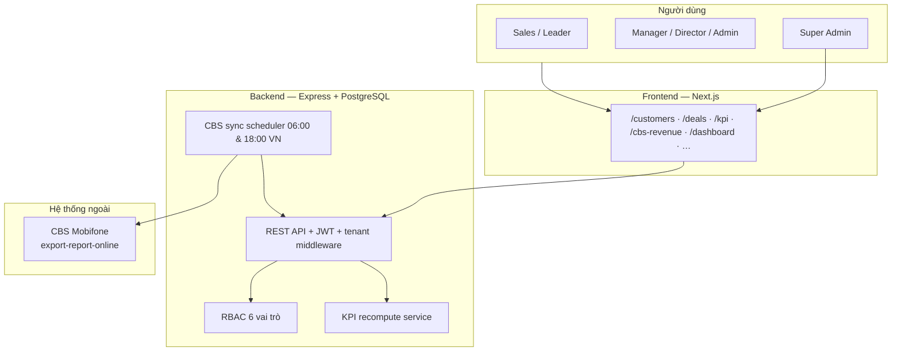
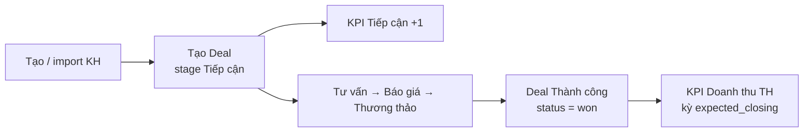
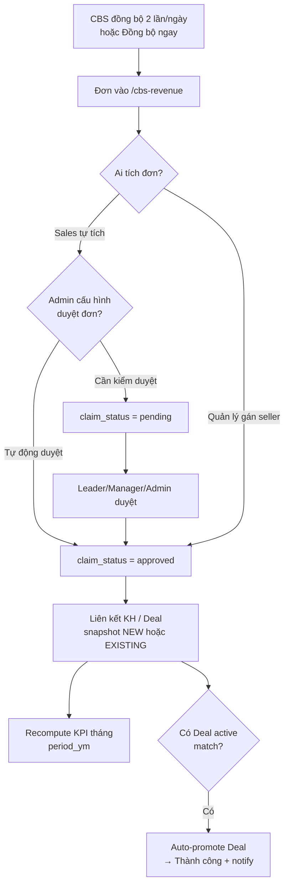
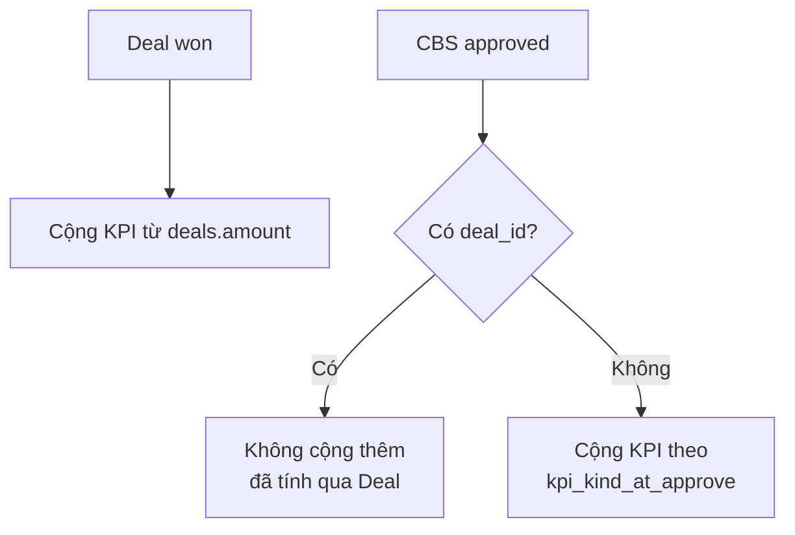
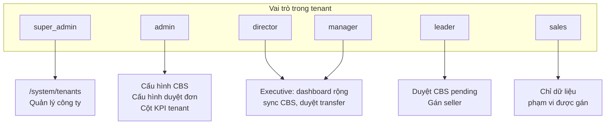
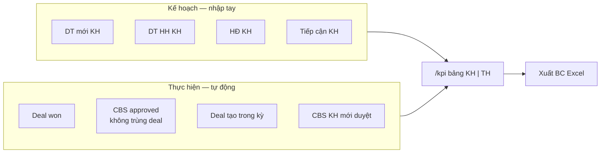
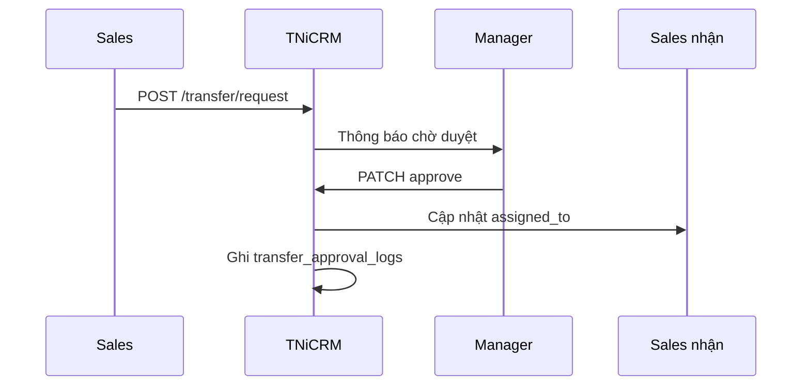
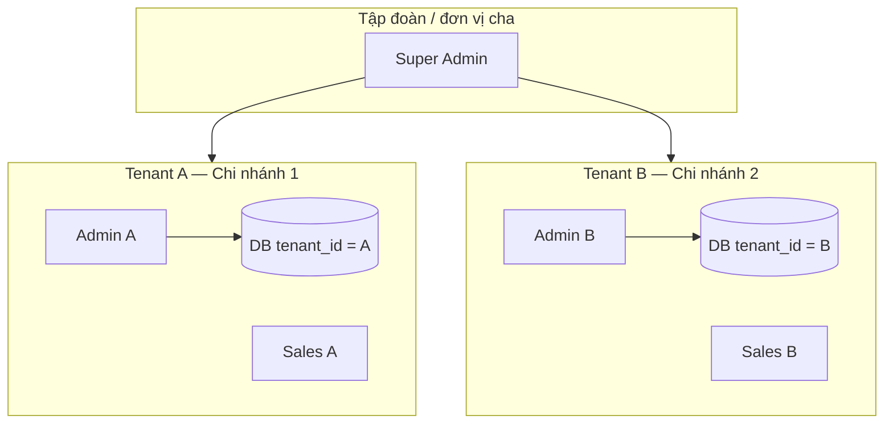

# SÁNG KIẾN — Hệ thống TNiCRM

**Tên sáng kiến:** Hệ thống quản lý quan hệ khách hàng và KPI bán hàng tích hợp CBS — **TNiCRM**

**Đơn vị / tác giả:** *(điền tên đơn vị, họ tên người đề xuất)*

**Thời gian triển khai:** *(điền: bắt đầu — đưa vào vận hành)*

**Phiên bản tài liệu:** 2026-05 — cập nhật theo các tính năng mới nhất trên mã nguồn

---

## 1. MỤC TIÊU

Xây dựng và vận hành **TNiCRM** — nền tảng CRM đa chi nhánh (multi-tenant) phục vụ đội kinh doanh B2B/B2C, khép kín luồng:

**Khách hàng → Cơ hội (Deal) → Công việc → KPI tháng → Doanh thu CBS → Báo cáo**

Giảm phụ thuộc file Excel rời rạc, thống nhất số liệu giữa CRM và hệ thống hoá đơn CBS (Mobifone), minh bạch phân quyền và quy trình duyệt.

---

## 2. LÝ DO ĐỀ XUẤT GIẢI PHÁP

| Vấn đề trước đây | Hệ quả |
|------------------|--------|
| Dữ liệu KH, deal, KPI nằm rải rác Excel / email / CBS | Đối soát cuối kỳ chậm, sai lệch số liệu |
| Giao KPI thủ công, không có “Thực hiện” tự động | Khó theo dõi % đạt theo thời gian thực |
| Doanh thu CBS không gắn người bán trong CRM | Bỏ sót KPI, tranh chấp “đơn của ai” |
| Chuyển khách không có luồng duyệt | Mất audit, khó truy vết phụ trách |
| Lãnh đạo thiếu dashboard theo tổ chức | Ra quyết định chậm, thiếu số liệu thống nhất |

**Giải pháp:** Web app nội bộ (Node.js + PostgreSQL + Next.js), một luồng dữ liệu tập trung, tích hợp API CBS, phân quyền 6 vai trò (Super Admin, Admin, Director, Manager, Leader, Sales).

---

## 3. MỤC TIÊU CỦA GIẢI PHÁP

| Khía cạnh | Mục tiêu |
|-----------|----------|
| **Kinh tế** | Giảm giờ công báo cáo / đối soát; tăng độ chính xác KPI |
| **Kỹ thuật** | Nền tảng tập trung, API Swagger, đa tenant, ma trận quyền |
| **Tổ chức** | Minh bạch chuyển giao KH, phê duyệt deal lớn, chốt kỳ KPI (sau ngày 5 tháng kế tiếp — giờ VN) |
| **Mở rộng** | Nhân bản cho đơn vị khác qua tenant + Super Admin |

---

## 4. NỘI DUNG SÁNG KIẾN

### 4.1. Kiến trúc hệ thống

**Công nghệ:**

| Thành phần | Công nghệ |
|------------|-----------|
| Frontend | Next.js (App Router), React, Tailwind |
| Backend | Node.js, Express, PostgreSQL |
| Xác thực | JWT, đa tenant (`tenant_id`), gói dịch vụ (subscription) |
| Tài liệu API | Swagger tại `/api-docs` |

> **📷 CHỤP MÀN HÌNH (tùy chọn):** Trang Swagger `{backend}/api-docs` — minh hoạ API có tài liệu hoá.

---

### 4.2. Sơ đồ luồng nghiệp vụ lõi

#### Luồng A — Khách hàng → Deal → KPI

#### Luồng B — CBS → Duyệt đơn → KPI

#### Luồng C — Tránh đếm trùng doanh thu

---

### 4.3. Phân quyền (RBAC)

| Vai trò | Phạm vi điển hình |
|---------|-------------------|
| **Sales** | KH/deal/task của mình; tích đơn CBS; xem KPI cá nhân |
| **Leader** | Nhánh tổ + duyệt CBS / gán seller |
| **Manager / Director** | Phòng ban; giao KPI; duyệt chuyển giao; báo cáo |
| **Admin tenant** | Toàn tenant; cấu hình CBS, duyệt đơn, cột KPI, nhân viên |
| **Super Admin** | Quản lý nhiều tenant (hệ thống) |

> **📷 CHỤP MÀN HÌNH:** `/permissions` — Ma trận phân quyền theo module.

---

### 4.4. Danh mục module & chức năng đã triển khai

#### Module 1 — Đăng nhập & hồ sơ

| Chức năng | Mô tả |
|-----------|--------|
| Đăng nhập theo tenant | Username/password; subdomain/domain công ty |
| Super Admin | Quản lý tenant tại `/system/tenants` |
| Gói dịch vụ | Banner hết hạn; chặn ghi khi expired |
| Hồ sơ | `/profile` — đổi mật khẩu, ảnh đại diện |

> **📷 CHỤP MÀN HÌNH:** `/login` — Màn hình đăng nhập.

---

#### Module 2 — Khách hàng (`/customers`)

| Chức năng | Mô tả |
|-----------|--------|
| CRUD khách hàng | Cá nhân, tổ chức; MST, SĐT, địa chỉ, nguồn |
| **Trạng thái hoạt động** | `is_active` — KH đang hoạt động / đã khóa |
| **Phân loại KPI** | NEW / EXISTING; lọc Tất cả / KH Mới / KH Hiện hữu |
| Tìm kiếm & lọc bảng | Tên, công ty, SĐT, MST, loại KH, người phụ trách |
| Import Excel | Mẫu + upload hàng loạt |
| **Xuất Excel** | Xuất danh sách đang hiển thị (theo bộ lọc) |
| Chuyển giao | Yêu cầu chuyển (Sales) hoặc chuyển trực tiếp (quản lý) |
| Bulk transfer | Chuyển nhiều KH cùng lúc |
| Chi tiết KH | Timeline tương tác, lịch sử sở hữu, deal liên quan |

> **📷 CHỤP MÀN HÌNH:** `/customers` — Bảng KH + thanh tìm kiếm + lọc NEW/EXISTING + nút Xuất Excel.  
> **📷 CHỤP MÀN HÌNH:** `/customers/{id}` — Chi tiết KH + timeline.

---

#### Module 3 — Cơ hội / Deal (`/deals`)

| Chức năng | Mô tả |
|-----------|--------|
| Kanban pipeline | Kéo-thả stage; cấu hình stage theo tenant (MASS / PROJECT) |
| Mã hiển thị | `DEAL-YYMM-NNN` |
| Confidence | High / Medium / Low (Low bắt buộc ghi chú) |
| Phê duyệt deal lớn | Deal vượt ngưỡng cần duyệt (theo cấu hình) |
| Đóng thua / huỷ | Bắt buộc lý do thất bại |
| Đính kèm file | Upload, preview, tải xuống |
| Timeline hoạt động | Ghi chú + log hệ thống (kể cả auto-promote từ CBS) |
| Thùng rác | Soft delete; Admin khôi phục tại `/deals/trash` |
| Task tự sinh | Listener tạo task khi đổi stage (vd. MASS → Báo giá) |

> **📷 CHỤP MÀN HÌNH:** `/deals` — Kanban pipeline đầy đủ cột.  
> **📷 CHỤP MÀN HÌNH:** Chi tiết deal — timeline có dòng `[CBS] Auto-promote…` (nếu có).

---

#### Module 4 — Công việc (`/tasks`)

| Chức năng | Mô tả |
|-----------|--------|
| CRUD task | Gán người, hạn, liên kết KH/Deal |
| Mã hiển thị | `TSK-YYMM-NNN` |
| Hoàn thành | Ghi nhận kết quả; có thể sinh interaction |
| Lọc & tra cứu | Theo mã display code |

> **📷 CHỤP MÀN HÌNH:** `/tasks` — Danh sách / modal chi tiết task.

---

#### Module 5 — KPI tháng (`/kpi`) — *cập nhật mới*

| Chức năng | Mô tả |
|-----------|--------|
| Giao **Kế hoạch (KH)** | Doanh thu mới, doanh thu hiện hữu, **hợp đồng (1 chỉ tiêu)**, tiếp cận |
| **Thực hiện (TH)** | Tự sync từ Deal won + CBS approved |
| Cột bảng | **STT → Nhân viên → Địa bàn → Hợp đồng → DT Tổng → DT mới → DT HH → Tiếp cận** |
| Mỗi chỉ tiêu | 2 cột con: **KH \| TH** và % đạt |
| Chế độ xem | Số tuyệt đối hoặc % (toggle trên trang) |
| Sắp xếp | Click header cột để sort |
| Tìm kiếm NV | Lọc theo tên / username |
| **Xuất báo cáo Excel** | Nút **Xuất BC** — file `Bao_cao_KPI_thang_YYYY-MM.xlsx` |
| **Cấu hình cột (Admin)** | Ẩn/hiện cột theo tenant (lưu server) |
| **Chốt kỳ** | Sau ngày 5 tháng kế tiếp (VN): khoá sửa TH; Admin mới sửa KH quá khứ |
| Deep-link CBS | Từ cột TH có thể mở `/cbs-revenue?period=…&seller=…&status=approved` |

> **📷 CHỤP MÀN HÌNH:** `/kpi` — Toàn bộ bảng với cột STT, HĐ (KH/TH), DT Tổng, nút **Lưu KH** và **Xuất BC**.  
> **📷 CHỤP MÀN HÌNH:** Popup **Cấu hình cột** (Admin).  
> **📷 CHỤP MÀN HÌNH:** Banner / icon **Kỳ đã chốt** khi xem tháng quá khứ (nếu có).

---

#### Module 6 — Doanh thu CBS (`/cbs-revenue`) — *cập nhật mới*

| Chức năng | Mô tả |
|-----------|--------|
| Đồng bộ CBS | Tự động **06:00 & 18:00** (giờ VN); nút **Đồng bộ ngay** theo kỳ chọn |
| Cấu hình CBS | Admin: username/password/unit CBS |
| **Cấu hình duyệt đơn** | Admin chọn: **Tự động duyệt** hoặc **Cần kiểm duyệt** khi Sales tự tích đơn |
| Gom dòng theo HĐ | Cùng `contract_no` → 1 dòng; tiền cộng dồn |
| Trạng thái seller | Chưa có người bán / Chờ duyệt / Đã duyệt |
| Gán người bán | Quản lý chọn Sales từ dropdown → auto-approve |
| Duyệt / Gỡ | Duyệt pending; unclaim (quản lý gỡ cả đơn đã duyệt) |
| Lọc đa tầng | Tab (Tất cả / Của tôi / Chờ duyệt…); lọc theo cột (KH, HĐ, giá, NV CBS…) |
| Thẻ thống kê | Tổng đơn, DT VAT, Của tôi, Đã xác nhận, Chờ duyệt, Chưa có người bán — click để lọc |
| Liên kết tự động | Match/tạo KH; match deal; auto-promote; notify |
| **Xuất Excel** | Xuất dữ liệu đang hiển thị |
| **Tính lại KPI** | Executive ghi đè TH từ toàn bộ CBS đã duyệt (thao tác cảnh báo) |
| Chi tiết đơn | Modal xem từng dòng con trong nhóm HĐ |

**Quy trình duyệt đơn (Admin cấu hình):**

| Chế độ | Hành vi khi Sales bấm “Tích là của tôi” |
|--------|----------------------------------------|
| **Cần kiểm duyệt** (mặc định) | `pending` → chờ Leader/Manager/Admin duyệt → mới tính KPI |
| **Tự động duyệt** | `approved` ngay → liên kết KH/Deal → recompute KPI |

> **📷 CHỤP MÀN HÌNH:** `/cbs-revenue` — Thanh công cụ có **Cấu hình duyệt đơn**, **Cấu hình CBS**, **Xuất Excel**.  
> **📷 CHỤP MÀN HÌNH:** Modal **Cấu hình duyệt đơn** — 2 lựa chọn radio.  
> **📷 CHỤP MÀN HÌNH:** Bảng CBS — dòng gom HĐ + badge **Chờ duyệt** / **Đã duyệt**.  
> **📷 CHỤP MÀN HÌNH:** Modal **Cấu hình CBS** (Admin).

---

#### Module 7 — Dashboard & báo cáo (`/dashboard`)

| Chức năng | Mô tả |
|-----------|--------|
| Thống kê tổng quan | Deal, task, doanh thu, tiến độ KPI |
| Leaderboard | Xếp hạng theo kỳ |
| Biểu đồ | Phân tích theo phòng / nhân viên |
| Báo cáo | Sales forecast, hiệu suất NV, loss analysis, nhật ký task |
| Xuất Excel | Một số báo cáo xuất phía client (ExcelJS) |

> **📷 CHỤP MÀN HÌNH:** `/dashboard` — Widget KPI progress + leaderboard.

---

#### Module 8 — Tổ chức & nhân viên

| Trang | Chức năng |
|-------|-----------|
| `/organization-structure` | Cây phòng / tổ / nhóm; ảnh hưởng phạm vi dữ liệu |
| `/employees` | CRUD nhân viên; import Excel; reset mật khẩu |
| **Xuất Excel NV** | Nút **Xuất Excel** (header) — xuất danh sách theo bộ lọc vai trò / phòng-tổ |
| Lọc NV | Vai trò, phòng/tổ, trạng thái active |

> **📷 CHỤP MÀN HÌNH:** `/organization-structure` — Cây tổ chức.  
> **📷 CHỤP MÀN HÌNH:** `/employees` — Bảng NV + nút **Xuất Excel**, **Import Excel**, **Thêm nhân viên**.

---

#### Module 9 — Chuyển giao khách hàng

| Trang | Chức năng |
|-------|-----------|
| `/transfers` | Sales tạo yêu cầu chuyển giao |
| `/transfer-approvals` | Manager/Director/Admin duyệt / từ chối |
| `/transfer-logs` | Nhật ký phê duyệt (audit) |

> **📷 CHỤP MÀN HÌNH:** `/transfer-approvals` — Hàng chờ duyệt.

---

#### Module 10 — Thông báo & hệ thống

| Chức năng | Mô tả |
|-----------|--------|
| Notification bell | Deal auto-promote, chuyển giao, CBS… |
| Super Admin | `/system/tenants` — tạo/sửa tenant |
| Subscription | Kiểm tra hạn gói; banner trên UI |

---

### 4.5. Điểm mới so với CRM thông thường

1. **Hai nguồn Thực hiện KPI:** Deal thắng + CBS đã duyệt (gom 1 KPI / hợp đồng khi cùng `contract_no`).
2. **Tiếp cận KPI:** Deal tạo trong kỳ + khách CBS mới (đã duyệt), có cơ chế khử trùng.
3. **Chốt kỳ KPI:** Sau ngày 5 (VN) tháng kế tiếp — bảo toàn số liệu báo cáo.
4. **Cấu hình cột KPI** lưu server theo tenant.
5. **Cấu hình duyệt đơn CBS** linh hoạt theo chính sách đơn vị (tự duyệt / kiểm duyệt).
6. **Luồng chuyển giao KH** có phê duyệt và nhật ký.
7. **Auto-link CBS ↔ Deal ↔ Customer** với promote deal và thông báo.
8. **Xuất Excel** tại KH, NV, KPI, CBS — phục vụ báo cáo ngoại tuyến.

---

## 5. TÍNH MỚI CỦA SÁNG KIẾN

- Tự phát triển cho nghiệp vụ đơn vị; không sao chép nguyên sản phẩm CRM thương mại.
- Tích hợp **KPI ↔ Deal ↔ CBS** trong **một luồng dữ liệu** — đặc thù triển khai nội bộ.
- Cho phép Admin **tự chọn** quy trình duyệt đơn CBS mà không cần sửa mã nguồn.
- Mã nguồn thuộc kiểm soát đơn vị; mở rộng multi-tenant không phụ thuộc license bên thứ ba.
- *(Điền)* Ngày công bố / phạm vi áp dụng nội bộ.

---

## 6. ĐÃ ĐƯỢC ÁP DỤNG / ÁP DỤNG THỬ

Đã triển khai đủ module lõi trên môi trường vận hành / dev:

- Đăng nhập đa tenant, RBAC, subscription
- Khách hàng (active, NEW/EXISTING, import/export)
- Deal Kanban, task, thông báo
- KPI: KH/TH, xuất BC, cấu hình cột, chốt kỳ
- CBS: sync, gom HĐ, duyệt đơn cấu hình được, xuất Excel
- Dashboard, chuyển giao, tổ chức, nhân viên (import/export)

*(Điền: tên đơn vị, ngày pilot, số user, số KH / deal / đơn CBS thực tế.)*

---

## 7. KẾT QUẢ ÁP DỤNG

### Trước khi áp dụng

- Tổng hợp KPI cuối tháng: nhiều file Excel, ước **… giờ/người** *(điền)*.
- Đối soát CBS: thủ công, dễ thiếu người bán hoặc trễ duyệt.
- Chuyển KH: không có nhật ký tập trung.

### Sau khi áp dụng

- Một cổng `/kpi` + **Xuất BC**; TH cập nhật từ Deal + CBS.
- `/cbs-revenue`: lọc nhanh, gom HĐ, **cấu hình duyệt** theo chính sách.
- Dashboard cho lãnh đạo theo kỳ và phạm vi tổ chức.
- `/employees` + `/customers`: **Xuất Excel** theo bộ lọc — giảm copy thủ công.

> **📷 CHỤP MÀN HÌNH / BẢNG:** So sánh thời gian báo cáo trước–sau *(tự lập bảng)*.  
> **📷 CHỤP MÀN HÌNH:** File Excel mẫu — `Bao_cao_KPI_thang_*.xlsx`, `Danh_sach_nhan_vien_*.xlsx`.  
> **📷 TÀI LIỆU:** Email / biên bản xác nhận lãnh đạo đơn vị *(người nộp đính kèm)*.

---

## 8. ĐIỀU KIỆN CẦN THIẾT ĐỂ ÁP DỤNG

| Hạng mục | Yêu cầu |
|----------|---------|
| Hạ tầng | Server Node.js + PostgreSQL; HTTPS / VPN nội bộ |
| CBS | Tài khoản CBS; Admin cấu hình tại **Cấu hình CBS** |
| Quy trình | Thống nhất: giao KPI, duyệt deal lớn, duyệt/chuyển KH, chính sách duyệt đơn CBS |
| Đào tạo | Theo vai trò; tham khảo `docs/HUONG_DAN_SU_DUNG.md` |
| Vận hành | Sao lưu DB định kỳ; theo dõi log sync CBS |

---

## 9. ĐÁNH GIÁ LỢI ÍCH

### Kinh tế

- Giảm chi phí nhập liệu trùng và báo cáo thủ công.
- Tránh bỏ sót doanh thu CBS không gán seller / chưa duyệt.
- *(Điền)*: Δ giờ × số NV × đơn giá giờ công = **… VNĐ/năm**.

### Thời gian

- Tổng hợp KPI: nhiều nguồn → một màn `/kpi` hoặc một file Excel.
- Tìm KH / NV: search + export thay vì lật sheet.

### Nhân lực

- Giảm nhu cầu nhân sự chuyên tổng hợp Excel.
- Quản lý giám sát trên dashboard; Sales tự theo dõi % đạt kế hoạch.

---

## 10. KHẢ NĂNG ÁP DỤNG

| Phạm vi | Mô tả |
|---------|--------|
| **Đơn vị** | Toàn bộ phòng KD dùng CBS + quản lý KH |
| **Tập đoàn** | Multi-tenant — mỗi chi nhánh một tenant; Super Admin tại `/system/tenants` |
| **Điều kiện** | Có pipeline bán hàng và nguồn doanh thu tích hợp được (CBS hoặc API tương đương) |
| **Giới hạn** | TNiCRM **không thay CBS** — là lớp quản trị KH, KPI, người bán |

---

## PHỤ LỤC A — Checklist chụp màn hình

| STT | Nội dung chụp | URL / ghi chú | Trạng thái |
|-----|---------------|---------------|------------|
| 1 | Đăng nhập | `/login` | ☐ |
| 2 | Dashboard tổng quan | `/dashboard` | ☐ |
| 3 | Danh sách khách hàng + export | `/customers` | ☐ |
| 4 | Chi tiết KH + timeline | `/customers/{id}` | ☐ |
| 5 | Kanban Deal | `/deals` | ☐ |
| 6 | Bảng KPI đầy đủ cột | `/kpi` | ☐ |
| 7 | Cấu hình cột KPI | `/kpi` → Cấu hình cột | ☐ |
| 8 | File Excel KPI | Tải từ **Xuất BC** | ☐ |
| 9 | CBS — thẻ thống kê + bảng | `/cbs-revenue` | ☐ |
| 10 | Modal Cấu hình duyệt đơn | `/cbs-revenue` → **Cấu hình duyệt đơn** | ☐ |
| 11 | Modal Cấu hình CBS | `/cbs-revenue` → **Cấu hình CBS** | ☐ |
| 12 | CBS — badge Chờ duyệt / Đã duyệt | `/cbs-revenue` | ☐ |
| 13 | Danh sách nhân viên + export | `/employees` | ☐ |
| 14 | Cây tổ chức | `/organization-structure` | ☐ |
| 15 | Ma trận phân quyền | `/permissions` | ☐ |
| 16 | Duyệt chuyển giao | `/transfer-approvals` | ☐ |
| 17 | Swagger API (tùy chọn) | `/api-docs` | ☐ |

**Lưu ý khi chụp:** Che hoặc bôi mờ SĐT, MST, doanh thu chi tiết, tên KH thật nếu hồ sơ công khai.

---

## PHỤ LỤC B — Sơ đồ triển khai multi-tenant

---

## PHỤ LỤC C — Tài liệu liên quan trong repo

| File | Mục đích |
|------|----------|
| `docs/HUONG_DAN_SU_DUNG.md` | Hướng dẫn sử dụng chi tiết |
| `docs/crm-logic-manifest.md` | Đặc tả hành vi theo mã nguồn |
| `docs/sang-kien/MO_TA_SANG_KIEN_TNiCRM.md` | Bản tóm tắt cũ (tham khảo) |
| `docs/sang-kien/Mau_don_SK.docx` | Mẫu đơn SK gốc (Word) — nếu cần nộp theo form |

---

*Tài liệu sáng kiến TNiCRM — soạn từ mã nguồn và tài liệu hệ thống. Điền các mục in nghiêng *(…)* trước khi nộp hồ sơ.*
