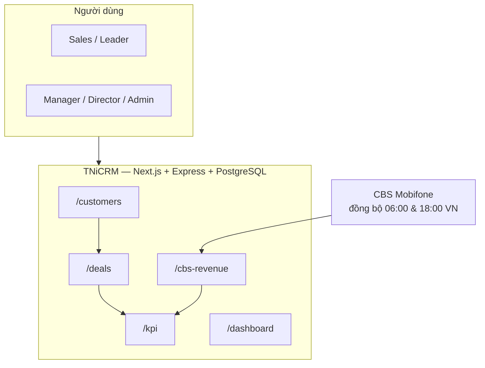
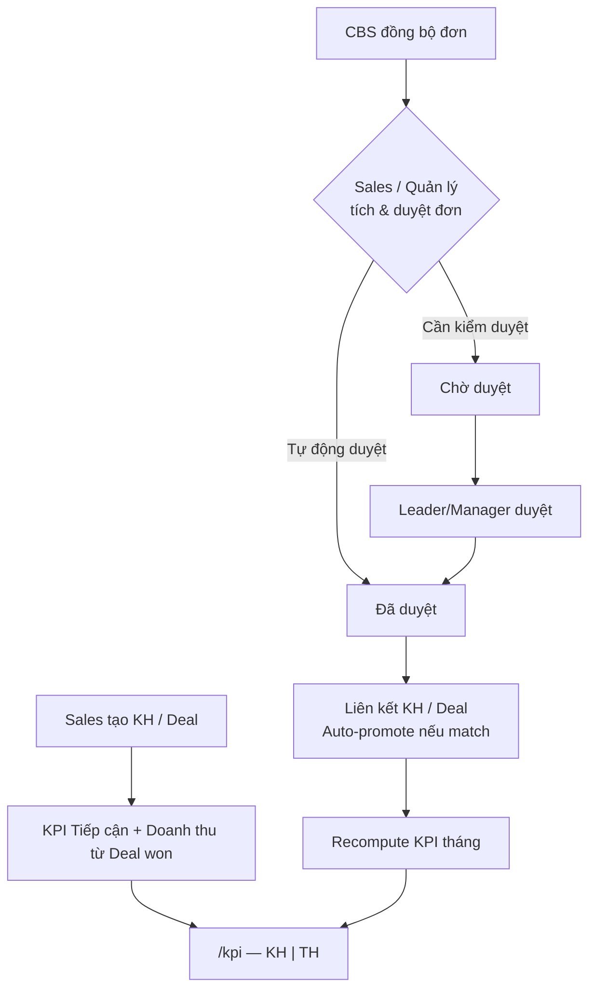

# ĐỀ NGHỊ CÔNG NHẬN SÁNG KIẾN

**Đề nghị công nhận sáng kiến:** Hệ thống quản lý quan hệ khách hàng và KPI bán hàng tích hợp CBS — **TNiCRM**

**Lĩnh vực áp dụng sáng kiến:** Giải pháp CNTT.

**Thời điểm bắt đầu áp dụng sáng kiến:** *(điền: dd/mm/yyyy — ví dụ 01/01/2025)*

**Địa điểm áp dụng:** *(điền: tên Công ty / Chi nhánh — ví dụ Công Ty Dịch Vụ MobiFone …)*

**Phạm vi áp dụng sáng kiến:** *(điền: Cấp cơ sở / Cấp TCT — tùy phạm vi triển khai)*

---

## MÔ TẢ SÁNG KIẾN

### Mục tiêu

Xây dựng và vận hành **TNiCRM** — hệ thống CRM đa chi nhánh (multi-tenant) phục vụ đội kinh doanh B2B/B2C, khép kín luồng **Khách hàng → Cơ hội (Deal) → Công việc → KPI tháng → Doanh thu CBS → Báo cáo**; giảm phụ thuộc file Excel rời rạc, thống nhất số liệu giữa CRM và hệ thống hoá đơn CBS (Mobifone), minh bạch phân quyền và quy trình duyệt đơn doanh thu.

---

### Lý do đề xuất giải pháp

Hiện nay, hoạt động kinh doanh tại đơn vị phải vận hành song song nhiều nguồn dữ liệu: danh sách khách hàng và cơ hội theo dõi trên file Excel hoặc sổ riêng; chỉ tiêu KPI tháng giao qua email/bảng tính; doanh thu thực tế ghi nhận trên **hệ thống CBS** (Mobifone) nhưng **chưa gắn thống nhất** với người bán và KPI trong một nền tảng quản trị. Hệ quả là cuối mỗi kỳ phải đối soát thủ công giữa CBS, deal đã chốt và bảng KPI — tốn thời gian, dễ sai lệch, khó truy vết khi tranh chấp “đơn của ai” hoặc khi chuyển giao khách hàng giữa nhân viên.

Bên cạnh đó, lãnh đạo và quản lý thiếu **một dashboard thống nhất** theo cơ cấu tổ chức (phòng/tổ/nhóm) để theo dõi tiến độ KPI, dự báo doanh thu và phân tích thất bại deal. Sales cũng không có công cụ tra cứu nhanh lịch sử khách hàng, tương tác và trạng thái duyệt đơn CBS trên cùng một giao diện.

Do đó, đơn vị đề xuất xây dựng **TNiCRM** — ứng dụng web nội bộ (Node.js + PostgreSQL + Next.js), tích hợp API đồng bộ CBS, tự động cập nhật **Thực hiện (TH)** KPI từ deal thắng và đơn CBS đã duyệt, hỗ trợ Admin **cấu hình linh hoạt** quy trình duyệt đơn (tự động duyệt hoặc cần kiểm duyệt), xuất báo cáo Excel phục vụ lưu trữ và trình bày ngoại tuyến. Giải pháp hướng tới giảm giờ công báo cáo, tăng độ chính xác số liệu và nâng cao tính minh bạch trong quản trị đội ngũ bán hàng.

---

### Mục tiêu của giải pháp

- Đưa ra **một cổng thông tin duy nhất** cho quản lý khách hàng, pipeline bán hàng, KPI tháng và doanh thu CBS.
- Công cụ **đơn giản theo vai trò** (Sales / Leader / Manager / Admin), truy cập qua trình duyệt, không cần cài đặt phần mềm riêng trên máy trạm.
- Tự động hóa **đối soát doanh thu CBS ↔ KPI** và liên kết khách hàng / deal khi duyệt đơn, giảm nhập liệu trùng.
- Cho phép **xuất Excel** danh sách khách hàng, nhân viên, KPI tháng, doanh thu CBS theo bộ lọc đang hiển thị.
- Hỗ trợ **nhân bản** cho đơn vị khác trong Tập đoàn qua mô hình multi-tenant và Super Admin.

---

### Nội dung

*(Mô tả đầy đủ các nội dung chính đã giải quyết để thực hiện sáng kiến. Các phần có kèm sơ đồ Mermaid — xuất ảnh qua [mermaid.live](https://mermaid.live) hoặc `mmdc` — và ảnh chụp màn hình thực tế.)*

---

#### 1. Lưu đồ tổng quan hệ thống

> **Hình 1 — Sơ đồ kiến trúc TNiCRM** *(xuất PNG từ sơ đồ trên, chèn vào hồ sơ)*

---

#### 2. Lưu đồ luồng nghiệp vụ KPI & CBS

> **Hình 2 — Luồng dữ liệu Deal + CBS → KPI**

---

#### 3. Các chức năng chính của TNiCRM

| STT | Module | Đường dẫn | Chức năng chính |
|-----|--------|-----------|-----------------|
| 1 | Đăng nhập & hồ sơ | `/login`, `/profile` | Đăng nhập theo tenant; đổi mật khẩu |
| 2 | Khách hàng | `/customers` | CRUD, import/xuất Excel, trạng thái active, phân loại NEW/EXISTING, chuyển giao |
| 3 | Cơ hội (Deal) | `/deals` | Kanban pipeline MASS/Dự án, confidence, phê duyệt deal lớn, đính kèm, thùng rác |
| 4 | Công việc | `/tasks` | Gán task, hạn, liên kết KH/Deal, hoàn thành |
| 5 | KPI tháng | `/kpi` | Giao **Kế hoạch (KH)**; **Thực hiện (TH)** tự sync; STT; xuất BC Excel; cấu hình cột |
| 6 | Doanh thu CBS | `/cbs-revenue` | Sync CBS, gom theo HĐ, gán seller, **cấu hình duyệt đơn**, xuất Excel |
| 7 | Dashboard | `/dashboard` | Thống kê, leaderboard, báo cáo forecast / hiệu suất / loss analysis |
| 8 | Tổ chức | `/organization-structure` | Cây phòng / tổ / nhóm |
| 9 | Nhân viên | `/employees` | CRUD, import/xuất Excel, reset mật khẩu |
| 10 | Phân quyền | `/permissions` | Ma trận quyền theo role |
| 11 | Chuyển giao | `/transfers`, `/transfer-approvals` | Yêu cầu, duyệt, nhật ký audit |
| 12 | Hệ thống | `/system/tenants` | Super Admin quản lý tenant |

---

#### 4. Giao diện ứng dụng

##### 4.1. Trang Đăng nhập

Người dùng nhập **Tên đăng nhập**, **Mật khẩu** và (tuỳ cấu hình) **domain / subdomain** công ty. Hệ thống xác thực JWT và gắn `tenant_id` cho phiên làm việc.

> **📷 Hình 3 — Đăng nhập** (`/login`)

---

##### 4.2. Dashboard — Tổng quan

Hiển thị thống kê deal, task, tiến độ KPI theo kỳ, leaderboard nhân viên, widget deal sắp đóng. Lãnh đạo / quản lý theo dõi nhanh tình hình kinh doanh toàn phòng.

> **📷 Hình 4 — Dashboard** (`/dashboard`)

---

##### 4.3. Quản lý khách hàng

- Danh sách KH: tìm kiếm đa trường (tên, SĐT, MST, công ty), lọc theo loại KH, phân loại KPI (Mới / Hiện hữu), trạng thái hoạt động.
- **Import Excel** hàng loạt; **Xuất Excel** danh sách đang hiển thị (theo bộ lọc).
- Chi tiết KH: timeline tương tác, deal liên quan, lịch sử sở hữu.
- **Yêu cầu chuyển giao** (Sales) hoặc chuyển trực tiếp (quản lý).

> **📷 Hình 5 — Danh sách khách hàng** (`/customers`)  
> **📷 Hình 6 — Chi tiết khách hàng + timeline** (`/customers/{id}`)

---

##### 4.4. Cơ hội bán hàng (Deal) — Kanban

- Kéo-thả deal giữa các giai đoạn pipeline (MASS / PROJECT).
- Mã hiển thị `DEAL-YYMM-NNN`; độ tin cậy High/Medium/Low.
- Deal lớn cần phê duyệt; đóng thua bắt buộc lý do.
- Timeline ghi nhận hoạt động, kể cả auto-promote từ CBS.

> **📷 Hình 7 — Kanban Deal** (`/deals`)

---

##### 4.5. KPI tháng

- Bảng KPI: **STT → Nhân viên → Địa bàn → Hợp đồng → DT Tổng → DT mới → DT HH → Tiếp cận**; mỗi chỉ tiêu có cột **KH | TH** và % đạt.
- Quản lý nhập **Kế hoạch**; **Thực hiện** tự cập nhật từ Deal won + CBS đã duyệt.
- Chế độ xem **Số** hoặc **%**; sắp xếp theo cột; tìm nhân viên.
- Nút **Lưu KH**; nút **Xuất BC** → file `Bao_cao_KPI_thang_YYYY-MM.xlsx`.
- Admin: **Cấu hình cột** ẩn/hiện theo tenant.
- **Chốt kỳ:** sau ngày 5 tháng kế tiếp (giờ VN) — khoá sửa TH; Admin mới chỉnh KH quá khứ.

> **📷 Hình 8 — Bảng KPI đầy đủ cột** (`/kpi`)  
> **📷 Hình 9 — Cấu hình cột KPI (Admin)**  
> **📷 Hình 10 — File Excel KPI xuất ra**

---

##### 4.6. Doanh thu CBS

- **Đồng bộ tự động** 06:00 và 18:00 (giờ VN); nút **Đồng bộ ngay** theo kỳ chọn.
- **Cấu hình CBS** (Admin): username/password/unit kết nối Mobifone.
- **Cấu hình duyệt đơn** (Admin): chọn **Tự động duyệt đơn** hoặc **Cần kiểm duyệt đơn** khi Sales tự tích đơn.
- Bảng **gom dòng theo số hợp đồng**; lọc tab (Tất cả / Của tôi / Chờ duyệt / …) và lọc theo cột.
- Thẻ thống kê: Tổng đơn, DT VAT, Chờ duyệt, Chưa có người bán — click để lọc nhanh.
- Quản lý **gán người bán**, **duyệt**, **gỡ** đơn; Sales **tích đơn của mình**.
- Khi duyệt: tự liên kết/tạo KH, match deal, auto-promote deal, recompute KPI.
- **Xuất Excel**; **Tính lại KPI** (executive, có cảnh báo).

> **📷 Hình 11 — Trang Doanh thu CBS + thẻ thống kê** (`/cbs-revenue`)  
> **📷 Hình 12 — Modal Cấu hình duyệt đơn**  
> **📷 Hình 13 — Modal Cấu hình CBS**  
> **📷 Hình 14 — Trạng thái Chờ duyệt / Đã duyệt trên bảng**

---

##### 4.7. Quản lý nhân viên

- Danh sách nhân viên: lọc vai trò, phòng/tổ; trạng thái active.
- **Import Excel**; **Xuất Excel** (header trang) theo bộ lọc.
- Admin: thêm NV, sửa chi tiết, **đặt lại mật khẩu**.

> **📷 Hình 15 — Danh sách nhân viên + Xuất Excel** (`/employees`)

---

##### 4.8. Cơ cấu tổ chức & phân quyền

- Cây phòng / tổ / nhóm — ảnh hưởng phạm vi dữ liệu và giao việc.
- Ma trận phân quyền theo module và role.

> **📷 Hình 16 — Cơ cấu tổ chức** (`/organization-structure`)  
> **📷 Hình 17 — Ma trận phân quyền** (`/permissions`)

---

##### 4.9. Chuyển giao khách hàng

- Sales tạo yêu cầu chuyển giao → Manager/Director/Admin duyệt hoặc từ chối.
- Nhật ký phê duyệt lưu tại `/transfer-logs`.

> **📷 Hình 18 — Duyệt chuyển giao** (`/transfer-approvals`)

---

##### 4.10. Chức năng khác

- **Thông báo** (notification bell): deal auto-promote, chuyển giao, CBS…
- **Swagger API** tại `/api-docs` — tài liệu hoá API cho tích hợp / bảo trì.
- **Super Admin** — quản lý nhiều tenant tại `/system/tenants`.
- **Gói dịch vụ (subscription):** banner hết hạn; chặn thao tác ghi khi expired.

> **📷 Hình 19 — Swagger API (tùy chọn)**

---

### Kết quả áp dụng

| Mô tả đối tượng **trước** khi áp dụng sáng kiến | Mô tả đối tượng **sau** khi áp dụng sáng kiến (kinh tế, kỹ thuật, tổ chức…) |
|------------------------------------------------|-------------------------------------------------------------------------------|
| Dữ liệu KH, deal, KPI nằm rải rác nhiều file Excel; mỗi kỳ phải tổng hợp thủ công, ước **… giờ/người** *(điền)* | Một cổng `/kpi` + **Xuất BC**; TH tự cập nhật từ Deal + CBS; giảm còn **… giờ** *(điền)* |
| Doanh thu CBS trên hệ thống Mobifone **không gắn** người bán trong CRM; đối soát cuối tháng dễ thiếu/sai | `/cbs-revenue` đồng bộ, gom HĐ, gán seller, duyệt đơn (cấu hình được); KPI cập nhật sau duyệt |
| Chuyển khách hàng qua chat/email, không audit | Luồng `/transfers` + duyệt + `/transfer-logs` |
| Lãnh đạo thiếu số liệu realtime theo tổ chức | `/dashboard` + báo cáo + leaderboard theo kỳ |
| Sales không biết đơn CBS của mình đã duyệt chưa | Trạng thái rõ ràng: Chưa có người bán / Chờ duyệt / Đã duyệt; deep-link từ KPI sang CBS |

---

### Các điều kiện cần thiết để áp dụng sáng kiến

- Máy trạm / điện thoại có trình duyệt web; truy cập mạng nội bộ hoặc VPN (HTTPS).
- Server triển khai **Node.js + PostgreSQL** (theo `DEPLOYMENT.md`).
- Tài khoản **CBS Mobifone** — Admin cấu hình tại **Cấu hình CBS** trên `/cbs-revenue`.
- Đào tạo theo vai trò; tài liệu `docs/HUONG_DAN_SU_DUNG.md`.
- Thống nhất quy trình nội bộ: giao KPI đầu tháng, chính sách **duyệt đơn CBS**, duyệt chuyển giao KH, chốt kỳ KPI.
- Sao lưu cơ sở dữ liệu định kỳ.

---

### Đánh giá lợi ích thu được

#### Về Kỹ thuật

- Nền tảng web tập trung, kiến trúc **multi-tenant**, API Swagger, mã nguồn thuộc kiểm soát đơn vị.
- Tích hợp **KPI ↔ Deal ↔ CBS** trong một luồng — chưa có quy trình bắt buộc tương đương sẵn có nội bộ.
- Giao diện theo vai trò (RBAC 6 cấp); cấu hình cột KPI và **cấu hình duyệt đơn** không cần sửa mã nguồn.
- Xuất Excel phía client (KH, NV, KPI, CBS) phục vụ báo cáo ngoại tuyến.

#### Về Kinh tế

- Giảm chi phí nhập liệu trùng và báo cáo thủ công cuối kỳ.
- Tránh bỏ sót doanh thu CBS chưa gán người bán / chưa duyệt → KPI và hoa hồng phản ánh đúng hơn.
- *(Điền phương pháp tính)*: Δ giờ công đối soát × số nhân viên × đơn giá giờ = **… VNĐ/năm**.

#### Khả năng áp dụng

- Triển khai tại **cấp đơn vị** có sử dụng CBS và quy trình bán hàng B2B/B2C.
- **Nhân rộng** trong Tập đoàn: mỗi chi nhánh một tenant; Super Admin quản lý tại `/system/tenants`.
- Không thay thế CBS — TNiCRM là **lớp quản trị** KH, KPI và người bán trên doanh thu CBS.

---

### Cam đoan

Tôi (chúng tôi) xin cam đoan mọi thông tin nêu trong đơn là trung thực, đúng sự thật và hoàn toàn chịu trách nhiệm trước pháp luật.

*(điền địa danh), ngày … tháng … năm …*

| **Xác nhận của đơn vị** | **Chủ trì sáng kiến** |
|-------------------------|------------------------|
| *(ký, ghi rõ họ tên và đóng dấu)* | *(ký, ghi rõ họ tên)* |

---

## PHỤ LỤC — Checklist ảnh & sơ đồ cho hồ sơ

| Hình | Nội dung | Nguồn |
|------|----------|--------|
| Hình 1 | Sơ đồ kiến trúc | Mermaid — mục 1 |
| Hình 2 | Luồng KPI & CBS | Mermaid — mục 2 |
| Hình 3–19 | Chụp màn hình UI | Theo mục 4.1–4.10 |
| File Excel mẫu | KPI / NV / CBS | Xuất từ hệ thống |

**Xuất sơ đồ Mermaid:** [https://mermaid.live](https://mermaid.live) → dán code → Export PNG/SVG.

**Tài liệu tham khảo trong repo:** `docs/sang-kien/SangKien.md`, `docs/HUONG_DAN_SU_DUNG.md`, `docs/crm-logic-manifest.md`

---

*Phiên bản: 2026-05 — theo mẫu SKKN_mInvoice.docx và mã nguồn TNiCRM hiện tại.*
